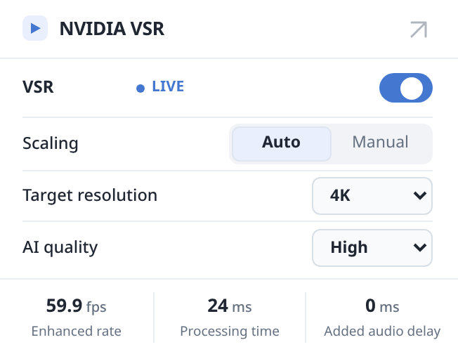
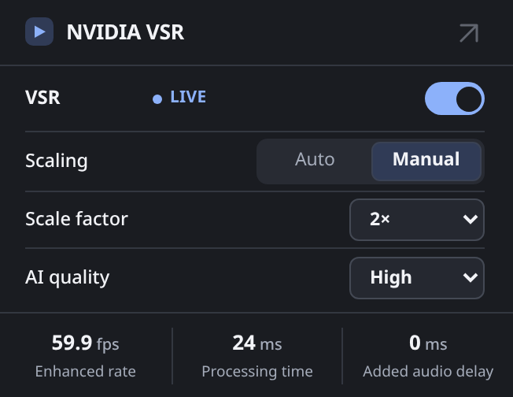

# NVIDIA VSR for Linux browsers

Real-time video enhancement in Helium using NVIDIA's **VideoSuperRes** AI effect, a local GPU service, and a Chromium extension.

The extension keeps the original player controls and audio, enhances decoded frames on the NVIDIA GPU, and presents them in a synchronized overlay. Auto mode fits a selected target: **1080p → 4K uses 2×**, **1440p → 4K uses 1.5×**. Quality and resolution are adjustable from the toolbar dashboard.

This is an independent, experimental integration using NVIDIA's VFX SDK. It does not enable the Windows driver's browser VSR switch. The AI effect is NVIDIA VideoSuperRes; there is no substitute upscaler or silent fallback. NVIDIA runtime software has separate licensing.

<p align="center"> </p>

## Status and requirements

Verified on CachyOS / KDE Plasma Wayland, RTX 5090, driver 615.78.08, and Helium 0.19.4.1 (Chromium 155). Other combinations need verification; this is not a general compatibility guarantee.

- Linux x86-64, an NVIDIA GPU supported by VideoSuperRes, and a driver compatible with the pinned CUDA 13 runtime and NVENC SDK 13.0.
- **AV1 NVENC support for the default browser pipeline**: RTX 40/50 series are candidates; GPU model support for VSR alone does not establish end-to-end compatibility. Check the [NVIDIA encode/decode matrix](https://developer.nvidia.com/video-encode-decode-support-matrix).
- Helium with extension support, WebCodecs, OffscreenCanvas and `requestVideoFrameCallback`. Other Chromium builds are experimental. Official Chrome restricts command-line unpacked extension loading; use its Developer mode UI if available.
- Working NVIDIA VA-API decoding for the verified GPU decoding path. See [nvidia-vaapi-driver's Chromium notes](https://github.com/elFarto/nvidia-vaapi-driver#chrome).
- `uv`, `g++`, FFmpeg, and Git on the host. Installation downloads Python 3.13 and the pinned Python/GPU dependencies into this folder. No system CUDA toolkit is installed.
- Several GB of free disk space and enough VRAM for input, output, AI workspace, encoding and the browser.

The [NVIDIA Python wheel requirements](https://pypi.org/project/nvidia-vfx/) and [SDK Linux support scope](https://docs.nvidia.com/maxine/vfx/latest/LinuxVFXSDK/GetStartedonLinux.html) describe upstream support. CachyOS and this desktop integration are community-tested configurations.

## Install and try it

Review [third-party licensing](THIRD_PARTY.md), then:

```bash
git clone https://github.com/maxiarat1/linux-nvidia-vsr.git
cd linux-nvidia-vsr
./scripts/install.sh
./vsr probe
./vsr browser
```

`probe` checks actual AI output against NVIDIA's bicubic reference; bicubic is only a diagnostic control. `browser` starts the service and an isolated Helium profile, loads the extension, and opens the generated motion test. It does not edit your normal browser profile.

For a different browser binary:

```bash
VSR_BROWSER=/absolute/path/to/browser ./vsr browser
```

1. Play the video, then open **NVIDIA VSR** in the extension toolbar.
2. Leave scaling on **Auto**, choose **4K** and **High**, then enable enhancement.
3. Check enhanced fps and processing time. Reduce target or AI quality if processing cannot keep pace.
4. Optional page controls include a hold-to-compare **Original** button; open the expanded dashboard (↗) and enable **Show controls on video page**. The floating panel is hidden by default. Hiding page controls from the dashboard keeps enhancement running.

The compact popup follows the browser-reported light/dark preference automatically, including changes while open. Custom Chrome theme accent colors are not exposed by the [public extension APIs](https://developer.chrome.com/docs/extensions/reference/api); the popup uses its own matching light/dark palette. Auto selects a target resolution; Manual selects a scale factor. The expanded dashboard also shows source/output dimensions and optional page controls.

For YouTube, open a video in this browser window. Its selected source resolution is independent of the enhancement target. Auto recalculates when the source resolution changes. Preferences persist; enhancement is opt-in for each video. The dashboard shows **Starting** until the first enhanced frame, then a **LIVE** indicator. Paused/hidden videos and original-resolution bypass are labeled explicitly. Turning off restores the original picture immediately; the helper’s idle-exit grace period does not delay that switch.

## Use your normal browser

```bash
./vsr install-browser-helper
```

This one-time setup registers a small browser native-messaging helper. After loading the extension, **Enable for this video** starts the engine automatically. Turning enhancement off lets the browser-managed engine exit after 30 seconds idle, releasing its CUDA context and GPU allocations. A paused stream unloads its AI effect after 15 seconds and reloads it on resume. There is no login service or always-running GPU engine. The extension itself cannot execute CUDA, so a local process remains necessary while enhancement is active.

Open `chrome://extensions`, enable **Developer mode**, choose **Load unpacked**, and select this repository's **`extension/`** directory. Pin **Local NVIDIA VSR** to the toolbar and refresh existing video tabs. Run `./vsr configure` after an update, then reload the extension and refresh the video page. The generated manifest and authorization are local to your installation; do not share that directory as a ready-made extension package.

On Arch-packaged Helium, `./vsr install-helium` offers an explicit flags-file setup with an undo record inside `.state/`. It preserves existing extension paths and feature lists, adds the verified NVIDIA/Wayland flags, and leaves restarting to you. `./vsr remove-helium` restores the saved flags if they have not been edited since installation.

On browsers that support it, `--load-extension=/absolute/path/to/extension` is another option. Preserve any existing extension paths in that flag. The [browser setup guide](docs/browser-setup.md) explains GPU flags, the Helium launcher, updates and removal. This project installs no system service. Helper registration uses a removable link in the browser profile; its executable, manifest, dependencies and recovery records stay in this project. Normal browser flags change only through the explicit `install-helium` command.

## How it works

```text
Browser GPU decode → NV12 pixels → loopback WebSocket
    → CUDA color conversion → NVIDIA VideoSuperRes → NVENC AV1
    → extension worker GPU decode → audio-timed OffscreenCanvas overlay
```

The expensive AI, color conversion and video codecs use the GPU on the verified setup. Raw input still crosses host memory between browser and service: this is not zero-copy. The original source codec can be AV1, VP9 or H.264; audio stays in the original browser player and is not re-encoded. AV1 output uses 8-bit BT.709 limited-range 4:2:0, QP 14, all keyframes.

A native NVENC adapter removes the extra three-frame queue found in the tested Python encoder wrapper. Worker rendering avoids coupling presentation to YouTube's main thread. Audio and video share a filtered clock; an adaptive audio delay is added only when processing needs it. See [architecture and timing findings](docs/architecture.md) before changing this pipeline.

## Performance and limits

On the tested RTX 5090, 1440p → 4K High delivered about **59.7 enhanced fps** in a short 60 fps YouTube run. Higher resolutions can exceed the processing budget. Auto selects a scale for a **resolution target**, not an automatic performance governor. It does not generate extra frames.

There is no fixed 1080p input or 4K output cap. Actual NVENC dimensions, GPU memory and a 64 MiB frame transport bound still apply. A source above the Auto target is displayed unchanged; an equal-size source is processed at 1×. Output dimensions are aligned to eight pixels, preserving aspect ratio to that rounding.

[Measured timing results](docs/performance.md) include cadence and A/V checks, methodology and limitations. Processing time excludes deliberate presentation waiting for the audio device. Software sync measurements do not measure physical speaker or display latency.

Known limitations:

- DRM/protected or non-origin-clean video cannot be captured. Some embedded players and site policies prevent attachment. The extension targets the largest visible video in the top-level page.
- HDR processing, frame generation, native video fullscreen, and picture-in-picture are not supported. Use the website player's fullscreen button; PiP shows the original.
- The current GPU worker is serialized; multiple simultaneous enhanced videos compete for it. Hidden tabs stop capturing.
- Disabling VSR removes the overlay and extra delay. A zero-delay Web Audio route remains until page reload because a MediaElementAudioSourceNode cannot be detached and recreated. Refresh for fully native audio routing.
- Errors restore the original picture. Site changes, driver versions, device latency and display refresh can affect results.

## Develop, integrate, troubleshoot

- [Development and verification](CONTRIBUTING.md)
- [Architecture and lessons from debugging](docs/architecture.md)
- [HTTP/WebSocket API and frame format](docs/api.md)
- [Browser setup and troubleshooting](docs/browser-setup.md)
- [Examples: dashboard preview, test video, image client](examples/README.md)
- [Agent working notes and invariants](AGENTS.md)

Useful commands:

```bash
./vsr status
./vsr stop
./vsr close-browser
node --test tests/presentation.test.cjs
```

All installed runtimes, caches, credentials, browser profiles and generated media stay in ignored project directories. To remove an isolated installation, close its browser and stop the service, then delete the clone. For a normal-profile installation, first run `./vsr remove-browser-helper`, remove the extension and any manually added browser flag or launcher; then delete the clone. Keep `.state/helium-profile` if you want to preserve that profile.

## License

For API development, `./vsr start` still starts a persistent service; `./vsr stop` stops it. The toolbar does not need that command.

Project source is [MIT licensed](LICENSE). NVIDIA SDKs, models and other dependencies retain their own licenses and are downloaded separately. See [THIRD_PARTY.md](THIRD_PARTY.md). NVIDIA and GeForce RTX are NVIDIA trademarks; this project is not affiliated with or endorsed by NVIDIA.
